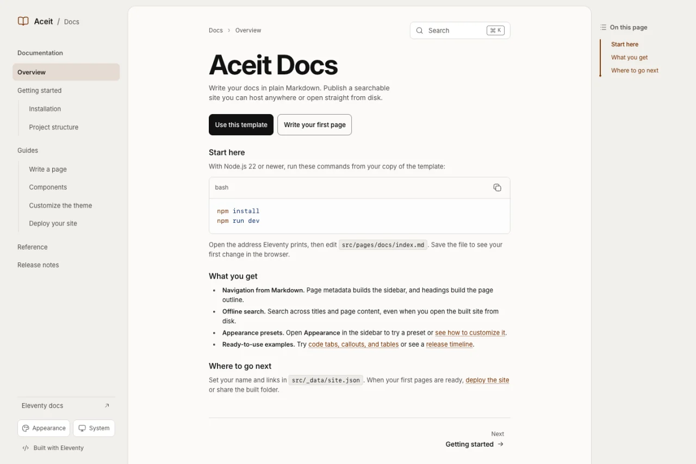

# Aceit Docs

An Eleventy documentation starter with plain Markdown, offline search, and theme presets. Build a static site you can publish on any host or open directly from disk.

[Live demo](https://aceit-docs.vercel.app/) · [Use this template](https://github.com/t4sh/aceit-docs/generate) · [Component examples](https://aceit-docs.vercel.app/guides/components/)



## Run it

Requires Node.js 22 or newer.

```bash
npm install
npm run dev
```

Open the address Eleventy prints. Edit [the homepage](src/pages/docs/index.md), save it, and watch the preview reload. Then change your site name and links in [site.json](src/_data/site.json).

```text
src/
├── pages/docs/   Markdown pages and navigation metadata
├── _data/       Site name, links, and appearance presets
├── _includes/   Nunjucks layouts and macros
└── assets/      CSS, fonts, and browser scripts
```

## Build and deploy

`npm run build` writes HTML, CSS, self-hosted fonts, and small browser scripts to `out/`. Open `out/index.html` from disk or copy the folder to any static host. For a public site, set `SITE_BASE_URL` to the final URL to generate canonical links, social cards, and a sitemap. The [deployment guide](src/pages/docs/guides/deploying.md) covers GitHub Pages, Cloudflare Pages, and Vercel.

`npm run check` runs the tests, builds the site, and checks that `CLAUDE.md` mirrors `AGENTS.md`.

## Add a page

Create a Markdown file under `src/pages/docs/`. Directory data gives it the docs layout and adds it to the `docs` collection. Add front matter:

```yaml
---
title: Your page
description: A short summary.
permalink: /your-page/
eleventyNavigation:
  key: Your page
  order: 5
---
```

Use `parent: Getting started` under `eleventyNavigation` to nest it below that page. Keys must be unique. The same collection drives the sidebar and generated search index.

## Customize

- Change the name and links in `src/_data/site.json`.
- To show **Edit this page** below each article, set `githubRepo` to your `owner/repo` and `githubBranch` to the branch containing your docs source (for example, `main`) in `src/_data/site.json`. The link is hidden if either setting is blank.
- Choose one of ten local presets in the Appearance menu. Seven docs presets offer Muted, Bright, and Rich palettes; Aceit Warm, Press, and Linen keep fixed colors. Presets also select local heading and body fonts. Press uses Atkinson Hyperlegible with Geist as its fallback; Foundry uses Geist. Supreme is optional and is not bundled: download it separately from Fontshare and follow the [installation instructions](src/pages/docs/guides/theming.md#optional-supreme-installation) to use it on your own site. Edit the theme CSS in `src/assets/css/themes/`; the shared type scale, dimensions, and component aliases live in `src/assets/css/tokens.css`.
- Adjust docs layout and components in `src/assets/css/docs.css`.
- Change the layout chain in `src/_includes/layouts/base.njk` and `docs.njk`.
- Replace the sample content in `src/pages/docs/` with your own documentation.
- Replace or delete the project-specific agent files: `.agent-memory/`, `AGENTS.md`, `CLAUDE.md`, and `docs/agents/`. They describe this template's repository, not yours. If you delete them, also remove the `sync:agent-docs` and `check:agent-docs` scripts and the check step in `package.json`.

## Why Eleventy

Astro gives you more out of the box, and it's a strong choice for many docs sites. This starter stays on Eleventy because it favors plain files and a site that keeps working with little attention:

- **Plain HTML you can take anywhere.** This is the main reason. The output is static HTML, CSS, and two small vanilla scripts, with no React, client framework, or bundler. Eleventy only turns your Markdown into those files, so you can copy `out/` to any static host, in any folder, or open `index.html` straight from disk. Links, fonts, and search work the same in each case. Packaging and deployment stay simple enough to hand to a coding agent.
- **Set and forget.** The aim is stability: few changes between versions, and no need to update unless you need something. Eleventy's 3.x line has been the stable release since October 2024. Astro moves faster, which brings fixes and features sooner and suits projects that want to keep pace.
- **No bundler.** There is no Vite or other bundler between your files and the site. Scripts in `src/assets/` are copied to the output unchanged and the stylesheets are joined in a fixed order, so you can read the published files directly.
- **Markdown stays Markdown.** Pages are ordinary `.md` files, and `{{ }}` and `` appear literally, which suits documentation about templates. Raw HTML covers small components. MDX isn't used: it treats `{` and `<` as code, and in Eleventy it would be a separate React-rendered path that skips this starter's Markdown plugins.
- **Reusable sections, self-contained scripts.** Sections are Nunjucks macros that render to static HTML. Behavior goes in a plain script file with no framework behind it. `src/assets/code-blocks.js` shows the pattern: one feature, one file, its own scope.

If your docs need stateful component demos or MDX, start from Astro instead. The full reasoning is in [ADR 0001](docs/adr/0001-stay-on-eleventy.md).

## Relationship to the source projects

| Source | Adapted here |
| --- | --- |
| Aceit Kit Starter | `src/pages/` input, sibling `_includes` and `_data`, `out/` output, Nunjucks layout chain, token-driven styling, three-mode theme preference |
| Aceit Demo Kit | Warm OKLCH palette, semantic surface and primary roles, compact offset shadows, crisp edges |

The starter keeps only the pieces a documentation site needs. It does not copy the marketplace pages, Tailwind browser build, CDN fonts/icons, standalone or SPA transforms, or the larger token catalog. This keeps the default build small while preserving the same authoring model. The token roles also follow [shadcn/ui's semantic theming](https://ui.shadcn.com/docs/theming); [Tailwind's theme documentation](https://tailwindcss.com/docs/theme) is a reference if you add utilities later.

Documentation Markdown is treated as trusted repository content. Raw HTML is enabled for small components; do not compile untrusted user or CMS Markdown as a page.

## Icons

Interface icons use [Hugeicons](https://hugeicons.com/), rendered as inline SVG during the build. Add icons to `lib/icons.js` and use `` in Nunjucks templates. Icon-only controls need an accessible label. The build includes the Hugeicons MIT license under `assets/licenses/`; no icon font, CDN request, or browser icon package is required.

The brand mark and favicon share the same book icon. Heading permalinks, keyboard hints, and control indicators use this icon source too; CSS masks keep native disclosure and search controls consistent without extra JavaScript.

## Code examples

Fenced code blocks use Shiki at build time, with paired light/dark syntax colors, copy buttons, optional filenames, highlighted lines, line numbers, and wrapping. Markdown code groups support independent examples or synchronized package-manager tabs. See the [authoring guide](src/pages/docs/guides/writing-pages.md) and [component examples](src/pages/docs/guides/components.md). Markdown preserves template syntax literally; Nunjucks is used for layouts and `.njk` pages.

## Content patterns

The component guide includes callouts, attributed quotations, keyboard keys, tables, and native disclosures. Figures and images fit the reading column; their captions share the type scale. The [release-notes example](src/pages/docs/release-notes.njk) uses a reusable [timeline macro](src/_includes/macros/timeline.njk), with a date column on desktop and a single column on mobile. Replace its sample history before publishing your documentation.

## License

The code in this repository is released under the [MIT License](LICENSE). Bundled third-party files keep their own licenses: the fonts in `src/assets/fonts/` use the SIL Open Font License 1.1, with notices in `src/assets/fonts/licenses/`, and Hugeicons uses MIT. Your own content and the sites you build from this template are yours.
